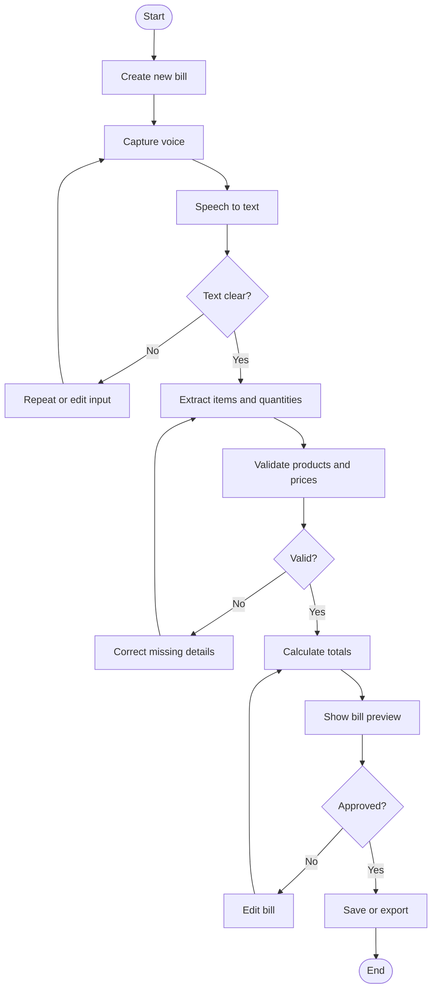

# Activity Diagram – Create Bill

## Workflow
Start → create bill → capture voice → convert speech to text → check clarity → extract items → validate products and prices → calculate totals → preview bill → review and correct → confirm → save/export → end.

If speech is unclear, request repetition or manual correction. If an item or price is missing, request correction before calculation/finalization.

## Mermaid Activity Flow

