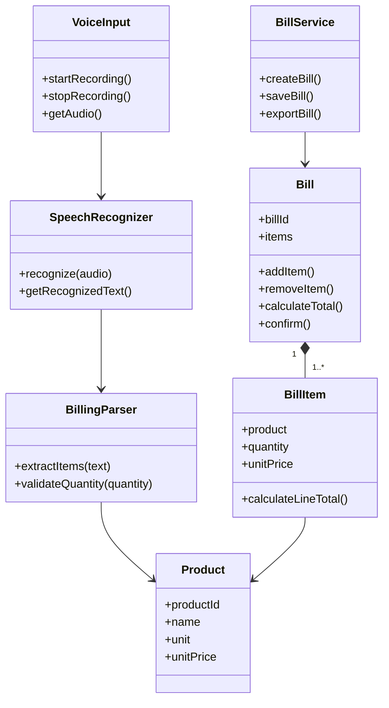

# Proposed Class Diagram

## Classes
- **VoiceInput**: startRecording(), stopRecording(), getAudio()
- **SpeechRecognizer**: recognize(audio), getRecognizedText()
- **BillingParser**: extractItems(text), validateQuantity(quantity)
- **Product**: productId, name, unit, unitPrice
- **BillItem**: product, quantity, unitPrice, calculateLineTotal()
- **Bill**: billId, items, addItem(), removeItem(), calculateTotal(), confirm()
- **BillService**: createBill(), saveBill(), exportBill()

## Mermaid Class Diagram

These are proposed abstractions; revise them to match the implementation language and architecture.
