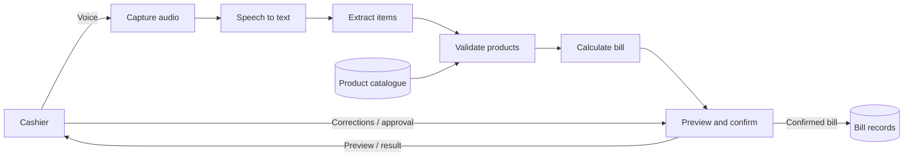

# Data Flow Diagram

## Context (Level 0)
External entity: Cashier / Shopkeeper. The user provides voice commands, corrections, and confirmation. The system returns recognized text, validation feedback, bill preview, and saved/exported bill.

## Level 1 Processes
1. Capture voice input.
2. Recognize speech and produce text.
3. Parse product names and quantities.
4. Validate products and retrieve prices.
5. Calculate line totals and bill total.
6. Present preview and save after confirmation.

## Data Stores
- D1: Product Catalogue
- D2: Confirmed Bill Records

## Mermaid Data-Flow Sketch

This is a conceptual model; update it to match the final architecture.
