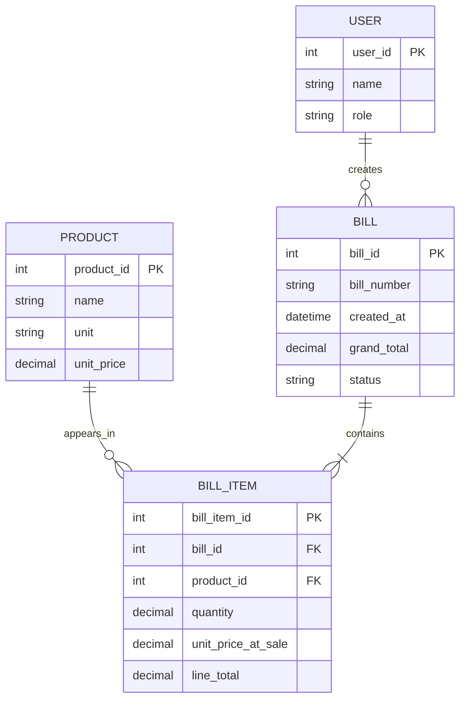

# ER Diagram

## Entities
**Product**: product_id (PK), name, unit, unit_price, active_status.

**Bill**: bill_id (PK), bill_number, created_at, subtotal, tax_amount, discount_amount, grand_total, status.

**BillItem**: bill_item_id (PK), bill_id (FK), product_id (FK), quantity, unit_price_at_sale, line_total.

**User** (optional): user_id (PK), name, role.

## Relationships
- One Bill contains one or more BillItems.
- One Product can appear in many BillItems.
- Each BillItem belongs to one Bill and references one Product.
- If accounts are implemented, one User may create many Bills.

## Mermaid ER Diagram

The User entity is optional. Finalize the schema during detailed design.
