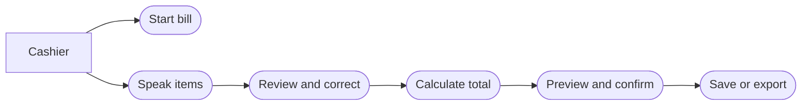

# Use-Case Model

## Actors
- Cashier / Shopkeeper
- Speech Recognition Service (if an external service is used)

## Use Cases
1. Start a new bill.
2. Enter items by voice.
3. Review recognized text.
4. Correct item details.
5. Search/select product.
6. Calculate bill.
7. Preview bill.
8. Confirm bill.
9. Save or export bill.

## Main Flow
Cashier starts a bill → speaks product and quantity → system recognizes speech → extracts items → validates products and prices → calculates totals → displays preview → cashier corrects if needed → cashier confirms → system saves or exports.

## Alternative Flows
- Unclear speech: ask the user to repeat or edit the text.
- Unknown product: ask the user to select or add a valid product.
- Missing price: prevent finalization until price is supplied.
- Save failure: show an error and do not claim the bill was saved.

## Flow Sketch

